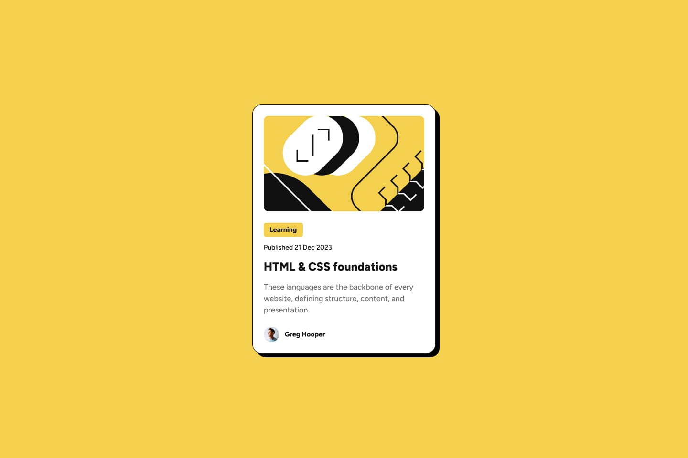
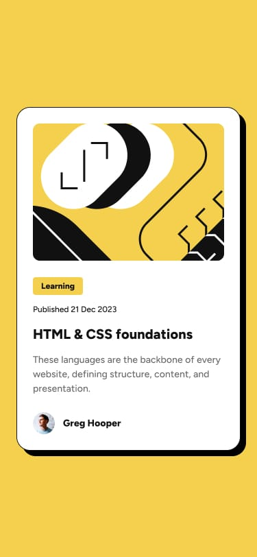

# Blog Preview Card

A responsive, single-card article preview built with semantic HTML and CSS. This Frontend Mentor project pairs clean typography with a bright background and a bold offset shadow.

[](https://developer.mozilla.org/en-US/docs/Web/HTML)
[](https://developer.mozilla.org/en-US/docs/Web/CSS)
[](#my-process)
[](https://blog-preview-card-main-mu-eosin.vercel.app/)

## Table of contents

- [Overview](#overview)
  - [The challenge](#the-challenge)
  - [Design previews](#design-previews)
  - [Links](#links)
- [My process](#my-process)
  - [Built with](#built-with)
  - [What I learned](#what-i-learned)
  - [Project structure](#project-structure)
- [Author](#author)
- [Acknowledgments](#acknowledgments)

## Overview

### The challenge

This project is a solution to the [Blog Preview Card challenge on Frontend Mentor](https://www.frontendmentor.io/challenges/blog-preview-card-ckPaj01IcS). The goal was to recreate a compact article card and make it work across screen sizes.

The finished page features:

- An article card with a clear content hierarchy, article illustration, publication date, title, description, and author information.
- A bold offset shadow that grows on card hover, reinforcing the design's neo-brutalist look.
- Hover and keyboard-focus styling for the article title link.
- Responsive typography and card layout adjustments for narrower screens.

### Design previews

The images below are the challenge's design references, included in the `design/` folder.

#### Desktop



#### Mobile



### Links

- **Live site:** [blog-preview-card-main-mu-eosin.vercel.app](https://blog-preview-card-main-mocha-seven.vercel.app/)
- **GitHub repository / solution source:** [AhmedHussien249/blog-preview-card-main](https://github.com/AhmedHussien249/blog-preview-card-main)
- **Challenge:** [Frontend Mentor - Blog Preview Card](https://www.frontendmentor.io/challenges/blog-preview-card-ckPaj01IcS)

## My process

### Built with

- Semantic HTML5
- Modern CSS3
- CSS Flexbox for page and author-row alignment
- Locally hosted Figtree fonts using `@font-face`
- Responsive styling with a CSS media query
- HSL color values

### What I learned

- **Semantic structure:** The page uses landmarks such as `<main>` and `<footer>`, with the card content grouped in an `<article>`.
- **Local typography:** `@font-face` loads the Figtree Medium and ExtraBold font files provided with the project assets.
- **Responsive type:** At viewport widths of 480px or less, the title and description use smaller font sizes to better fit the card.
- **Interactive feedback:** The title link changes color on `:hover` and `:focus`, and the card shadow shifts from an 8px to a 16px offset on hover. A short CSS transition smooths these changes.
- **Color management:** HSL values are used directly for the page background, card, text, and accent colors.

### Project structure

```text
blog-preview-card-main/
├── assets/
│   ├── fonts/
│   │   └── static/
│   │       ├── Figtree-ExtraBold.ttf
│   │       └── Figtree-Medium.ttf
│   └── images/
│       ├── favicon-32x32.png
│       ├── image-avatar.webp
│       └── illustration-article.svg
├── css/
│   └── style.css
├── design/
│   ├── active-states.jpg
│   ├── desktop-design.jpg
│   └── mobile-design.jpg
├── index.html
└── README.md
```

## Author

**Ahmed Hussien**

- GitHub: [@AhmedHussien249](https://github.com/AhmedHussien249)

## Acknowledgments

- [Frontend Mentor](https://www.frontendmentor.io/) for the challenge and design references.
- The project starter assets for the Figtree font and article illustrations.
